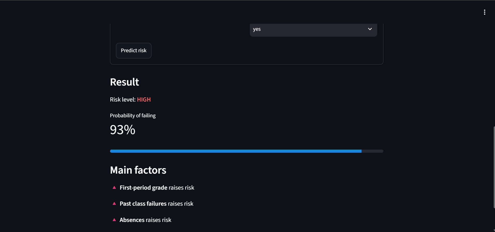
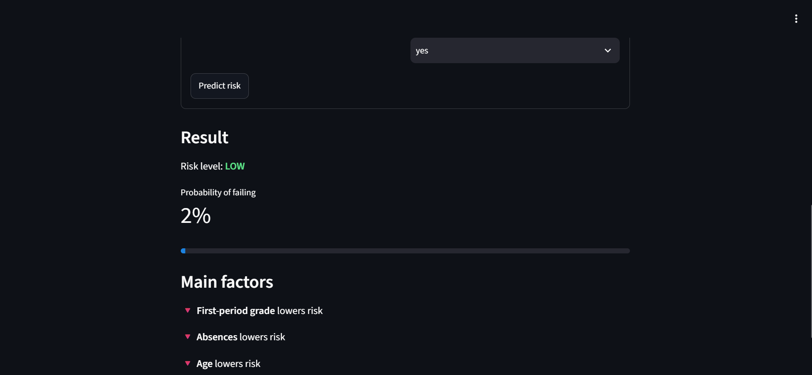
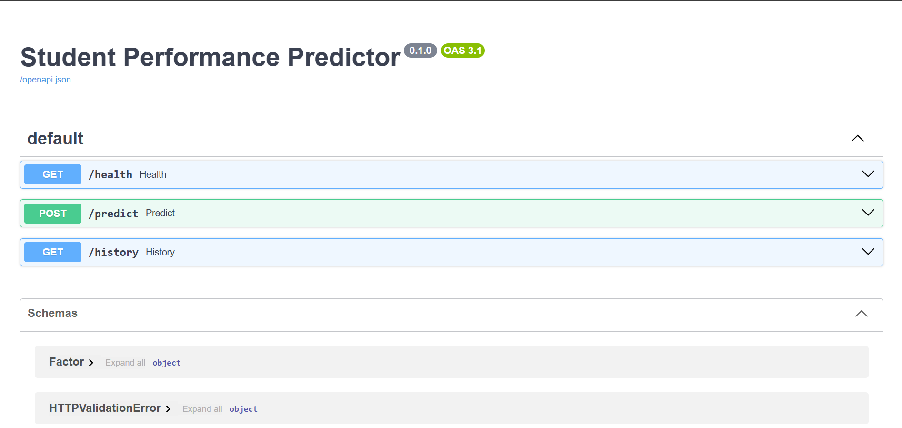

# 🎓 Student At-Risk Predictor


An early-warning tool that estimates the probability a student will fail a course after the first assessment, and explains which factors drive the prediction.

**[Live demo](https://student-predictor-1-tuql.onrender.com/)** · **[API docs](https://student-predictor-2x7v.onrender.com/docs)**
*(Hosted on a free tier: the first request may take up to a minute to wake the service.)*





## Features
- REST API (FastAPI) with validated input (Pydantic) and prediction history stored in SQLite
- Gradient Boosting classifier served through a scikit-learn pipeline
- Per-prediction explanations with SHAP (top 3 factors)
- Streamlit web interface
- Dockerized (API and frontend) with Docker Compose
- Automated tests (pytest) run on every push via GitHub Actions

## Architecture
```
Streamlit UI  --HTTP-->  FastAPI  -->  scikit-learn pipeline + SHAP
                            |
                         SQLite (prediction history)
```

## Model
- **Data:** UCI Student Performance dataset (Math course, 395 students)
- **Task:** predict "at risk" (final grade < 10 out of 20)
- **Features:** 15 inputs including first-period grade (G1), past failures, absences, study time, and family/school support. The second-period grade (G2) is deliberately excluded because it is too close to the final grade to be useful as an early warning.
- **Evaluation:** 5-fold cross-validation repeated 3 times on the training set, plus a held-out 20% test set, compared against a majority-class baseline

| Model | CV ROC-AUC |
|---|---|
| Baseline (most frequent) | 0.500 |
| Logistic Regression | 0.918 |
| Random Forest | 0.916 |
| **Gradient Boosting** | **0.923** |

Held-out test set (79 students): ROC-AUC 0.943, at-risk recall 0.77, precision 0.77.

### Limitations
- Small dataset (395 rows), so the test-set figures vary with the split; the cross-validated numbers are more reliable.
- The first-period grade carries most of the signal. Without it, ROC-AUC drops to about 0.66, so the model is only useful once an initial assessment exists.
- Data comes from two Portuguese schools; results may not generalize to other settings.
- This is a demonstration project, not a validated tool, and should not be used for real decisions about students.
- The free-tier deployment resets the SQLite history on restart. A production version would use PostgreSQL.

## Run locally

### With Docker
```bash
docker compose up --build
```
App: http://localhost:8501 · API docs: http://localhost:8000/docs

### Without Docker
```bash
python -m venv venv
venv\Scripts\activate          # macOS/Linux: source venv/bin/activate
pip install -r requirements-api.txt -r requirements-frontend.txt pytest httpx
python -m app.ml.train
uvicorn app.main:app --reload
streamlit run frontend/app.py   # in a second terminal
```

## Tests
```bash
pytest -v
```

## Project structure
```
app/            FastAPI app, schemas, database
app/ml/         training, features, SHAP explainer
frontend/       Streamlit app
tests/          API tests
data/           UCI dataset
```

## Data source
P. Cortez and A. Silva, *Using Data Mining to Predict Secondary School Student Performance*, 2008. UCI Machine Learning Repository.